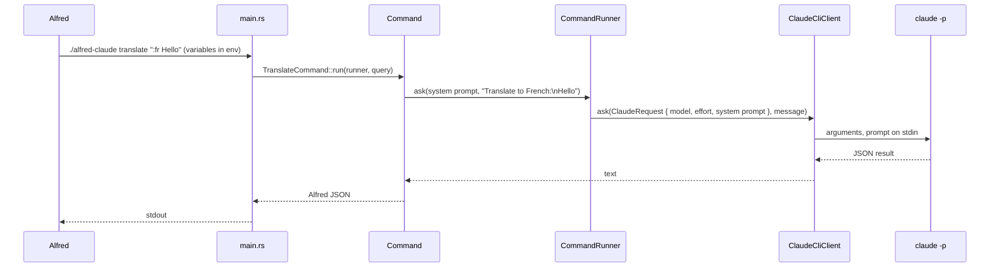

# Architecture

The workflow is one native binary, `alfred-claude`, called by Alfred for each query. It reads its configuration from the environment variables Alfred sets, runs the Claude Code CLI once and prints a Script Filter JSON document on stdout. It keeps no state between queries: authentication belongs to Claude Code.

## Request flow

1. Alfred runs `./alfred-claude <command> "$1"` from a Script Filter. The three entry points of each command (keyword, Universal Action, hotkey) feed the same Script Filter.
2. `main.rs` collects the arguments and the environment and dispatches to `AspellCommand`, `ClaudeCommand` or `TranslateCommand`.
3. The command builds its prompt and calls `CommandRunner::ask` with its own system prompt.
4. `CommandRunner` reads `model` and `level`, locates the CLI and calls `ClaudeCliClient::ask`.
5. The answer becomes a single Alfred item: Enter opens it in Text View, ⌘↵ copies it, ⌥↵ pastes it.

Every error is turned into an Alfred item titled `Error: …`, so a failure is always visible in Alfred instead of an empty result.

## Modules

| Module | Role |
| --- | --- |
| `main.rs` | Composition root: reads arguments and variables, prints the JSON |
| `command/` | One type per Alfred command, plus `CommandRunner` that resolves the model, the effort level and the CLI |
| `client/` | `ClaudeCliClient`: runs `claude -p` and parses its JSON result |
| `helper/` | Alfred JSON output and the translation prefix parser |
| `types/` | `ClaudeRequest` and `EffortLevel`, one per file |

The only external system is the Claude Code CLI, a child process. Tests run a fake `claude` script (`tests/fixture/FakeClaudeCli`) through the real `claude_path` variable, so production code has no test hooks.

## Configuration

All settings are Alfred workflow variables, read from the environment. Empty values count as unset.

| Variable | Used by | Default |
| --- | --- | --- |
| `model` | `CommandRunner` | `haiku` |
| `level` | `CommandRunner` | `low` |
| `default_lang` | `TranslateCommand` | `en` |
| `claude_path` | `ClaudeCliClient::locate` | `~/.local/bin/claude`, Homebrew, then `PATH` |

`claude_path` is listed in `variablesdontexport` in `info.plist`, so exporting the workflow never shares a local path.
